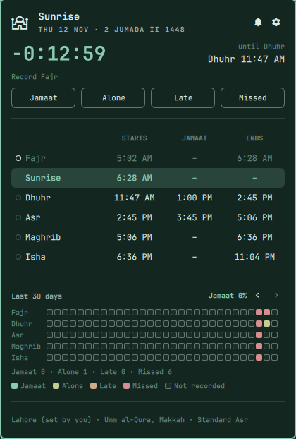

# Awqat

Prayer times for [Omarchy](https://omarchy.org), in the bar. *Awqāt* (أوقات)
means "times", as in *awqāt as-salāh*.

- Times calculated on your machine (the PrayTimes.org method), for wherever
  you are; Umm al-Qura, Karachi, MWL, ISNA, Egypt and more, Shafi'i or Hanafi Asr.
- A signed counter in the bar: `Asr +0:43`, then `Maghrib −0:29`.
- The azan as an alarm when each prayer begins, and a reminder before your
  masjid's jamaat.
- Record each prayer (Jamaat / Alone / Late / Missed) and see the last 30 days.
- English and Urdu.



## Install

```sh
omarchy plugin add https://github.com/abdulroufsidhu/omarchy-awqat.git --enable
```

Update with `omarchy plugin update abdulroufsidhu.awqat`, remove with
`omarchy plugin remove abdulroufsidhu.awqat`. Needs nothing beyond a standard
Omarchy install (`mpv`, `jq`, `curl`, `zdump`).

## Bar

The current prayer and a signed counter: `Asr +0:43` after a prayer begins,
until halfway to the next time, then `Maghrib −0:29` down to it. Between the
azan and a masjid jamaat it shows `Asr jamaat 3:45 PM`. Click to open the
panel; while the azan plays, a click stops it.

## Panel

- The current prayer, the counter with seconds, today's date and Hijri date.
- **Jamaat / Alone / Late / Missed** for the prayer that can be recorded now
  (Fajr stays recordable after sunrise). Pressing the selected one clears it.
- Today's **Starts / Jamaat / Ends**, the current time highlighted. Click a
  prayer's row to cycle its status.
- The **last 30 days** of your record, with your jamaat share; ‹ › pages
  back. Click a cell to change it.
- **Settings** (gear, or `,`).

Keys: `h`/`l` or ←/→ move between the status buttons, Enter records, `n`
turns azan and notifications on or off, `s` stops the azan, `r` finds your
location again, `,` opens settings, Esc goes back or closes.

## Settings

All on the panel's settings page, saved in this widget's entry in
`~/.config/omarchy/shell.json` (this Omarchy version doesn't show plugin
settings anywhere else).

| Setting | Default | |
|---|---|---|
| Location | Automatic | Looked up from your connection at `geo.omarchy.org` (the service Omarchy's weather uses): on start, every 6 hours, after sleep, when the system time zone changes. Moving over 15 km switches everything and says so. Or choose a city (Open-Meteo search) or type `lat, lon`, which stops all network use. |
| Time zone | Automatic | The place's zone (or the system's); any zone from `zone1970.tab` |
| Method | Umm al-Qura, Makkah | Karachi, MWL, ISNA, Egypt, Kuwait, Qatar, Singapore |
| Asr | Standard (Shafi'i) | Hanafi |
| Hijri adjustment | 0 | −2 … +2 days |
| Azan and notifications | on | Which prayers ring the azan; stop after N minutes (0 = never) |
| Masjid jamaat | none | Per prayer and Jumu'ah: `13:30`, `1:30 pm` or `+15` (minutes after the azan). The azan plays as a reminder N minutes before (default 20); it never interrupts an azan already playing. |
| Ask whether I prayed | on, 15 min before the time ends | A notification with Jamaat / Alone / Late / Missed |
| Shown in the bar | Counter | Next prayer, or both |

Status colours follow the theme's green, yellow, orange and red; override
with `colorJamaat`, `colorAlone`, `colorLate`, `colorMissed` (`#rrggbb`).

After sleep, a prayer that began up to 15 minutes ago still rings the azan;
later, a quiet "Asr has begun" note instead. A jamaat reminder due during
sleep still sounds if the jamaat hasn't started.

## Files

| File | |
|---|---|
| `Model.js` | Calculation, time zones (from `zdump -i`), events, jamaat, history parsing |
| `Panel.qml` | Bar, panel, settings page, location lookup, scheduling |
| `azan.sh` | Azan alarm, notifications, the check-in and its listener |
| `history.sh` | The only writer of `~/.local/share/abdulroufsidhu.awqat/history.json` |
| `i18n/` | English and Urdu |

## Commands

```sh
omarchy-shell abdulroufsidhu.awqat toggle      # open | close | settings
omarchy-shell abdulroufsidhu.awqat record late # jamaat | alone | late | missed
omarchy-shell abdulroufsidhu.awqat stopAzan
node tests/model_test.mjs                    # calculation, zones, events, parsing
```

`Model.js` is also the reference for the Android version: its test vectors
are generated from this file, so keep the two in step.

## Credits

- Calculation: the [PrayTimes.org](http://praytimes.org) method.
- Azan recordings from the Internet Archive, re-encoded as mono Opus:
  - `sounds/azan.ogg`: [Makkah Dhuhr adhan, Sheikh Yunus Khoja](https://archive.org/details/4-9-13MakkahDuhurAdhanSheikhYunusKhoja)
  - `sounds/azan-fajr.ogg`: [Fajr adhan, Sheikh Farooq Hadhrawi](https://archive.org/details/SheikhFarooqHadhrawi24thJuly10FajerAdhan)

  These were shared publicly without a stated license; they are not covered
  by the MIT license below. If you hold the rights and want them removed,
  open an issue. You can point the plugin at your own file with the
  `azanSound` / `azanFajrSound` keys (an absolute path) in
  the widget's entry in `~/.config/omarchy/shell.json`.
- Location lookup: [geo.omarchy.org](https://geo.omarchy.org) and
  [Open-Meteo](https://open-meteo.com) geocoding.

## License

MIT, see [LICENSE](LICENSE). The azan recordings are excluded (see Credits).
